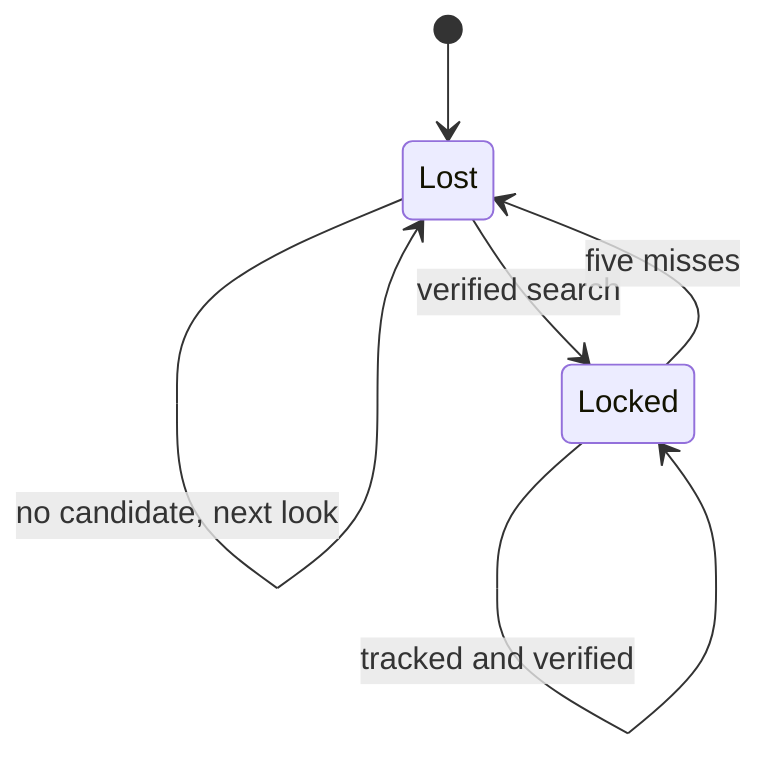

# Architecture

| Part | What | Build, test, run |
| --- | --- | --- |
| `crates/board` | `.kicad_pcb` reader, model with absolute coordinates, raster of a side | `cargo test -p pcbv-board` |
| `crates/vision` | images, spots, model features, constellation search, refinement, tracking, synthetic pictures, overlays | `cargo test -p pcbv-vision` |
| `crates/camera` | V4L2 capture thread | `cargo test -p pcbv-camera` |
| `crates/app` | `pcbv` commands and the live viewer | `mise run live -- board.kicad_pcb` |

```mermaid
flowchart LR
    PCB[board.kicad_pcb] --> P[pcbv-board: parse]
    P --> M[model: footprints, pads, tracks, vias, zones, outline]
    M --> R[render: copper and mask coverage, holes, silk]
    R --> F[BoardModel: island and hole centroids in the view frame, map picture]
    CAM[/dev/videoN/] --> C[pcbv-camera: MJPEG or YUYV to RGB]
    C --> L[Localizer]
    F --> L
    L --> D[spots: luma-local, chroma-global or holes look]
    D --> S{locked?}
    S -- no --> G[constellation search with verification]
    S -- yes --> T[re-anchor and refine from the last pose]
    G --> V[coverage and explained checks]
    T --> V
    V --> O[Pose: image to board homography, center, angle, scale]
    O --> UI[egui window: frame with overlays, board map]
    O --> J[JSON lines on stdout]
```

The localizer is a two state machine. Lost runs the search every
frame, cycling the look after each failure; Locked tracks from the
last pose and drops back to Lost after five frames without a verified
fit.

A frame's time on this laptop at 1280 by 720, locked on a masked board:

```mermaid
gantt
    title One tracked frame, milliseconds
    dateFormat x
    axisFormat %L
    section camera thread
    MJPEG decode            :a1, 0, 6
    section localizer thread
    shrink and channel      :b1, 6, 10
    local contrast, blobs   :b2, 10, 22
    re-anchor and refine    :b3, 22, 26
    coverage check          :b4, 26, 27
    section window
    upload texture, draw    :c1, 27, 33
```

A search frame replaces the refine step with 65 to 470 ms of
hypotheses and verifications, during which the window keeps showing
the last frame.

## Frames and coordinates

- Board frame: KiCad's, millimeters, x right, y down, as stored in the
  file.
- View frame: the board frame for the front side, mirrored in x for the
  back, so a picture of either side maps to it with a rotation, a scale
  and perspective.
- Work frame: the frame shrunk to at most 1024 px wide for detection;
  the pose is scaled back to full size pixels.

A pose carries `image_to_view` and `image_to_board`, both from full
size pixels.
